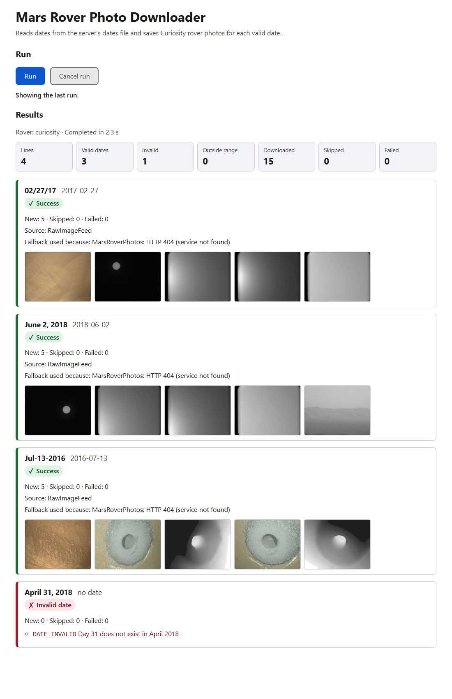

# Mars Rover Photo Downloader

Reads dates from a text file, validates them, finds Mars rover photos for each valid date, downloads them into `photos/<yyyy-MM-dd>/` without ever downloading the same photo twice, and reports exactly what happened: on the console, as JSON from an API, and on a small Angular page with thumbnails.



## Why this exists, and one surprise

The brief asks for NASA's **Mars Rover Photos API** with `earth_date`. When this was built (2026-10-06) that service was **gone**: every route under `https://api.nasa.gov/mars-photos/api/v1/` answers HTTP 404 with a "No such app" web page (the community backend it relied on no longer exists). So the app implements two photo sources behind one interface and tries them in order:

1. **Mars Rover Photos service** (as in the brief), implemented to its documented contract, so it works unchanged if the service comes back.
2. **NASA's public raw-image feed** (Curiosity only) as an **automatic fallback**. The feed is keyed by Mars day (sol), so the Earth date is converted to the sol that corresponds to it, which is also what the original service's `earth_date` meant (the first version filtered by capture time and found 0 photos for 2018-06-02; see `specs/001-mars-photo-downloader/research.md`).

Every result shows which source served it and why a fallback was used.

## Quick start

Prerequisites: **.NET 8 SDK**, **Node 20+** (for the UI), a free **NASA API key** from <https://api.nasa.gov>. Docker is optional.

```bash
# 1. Put your key in a git-ignored .env file (never commit it)
cp .env.example .env            # then edit .env and set NASA__ApiKey=<your key>

# 2. Console runner: reads dates.txt, saves photos, prints a summary
dotnet run --project src/MarsPhotos.Cli

# 3. API (http://localhost:5180) and UI (http://localhost:4200), in two terminals
dotnet run --project src/MarsPhotos.Api
cd src/marsphotos-ui && npm install && npm start
```

Open <http://localhost:4200>, press **Run**, and browse the results.

**API documentation:** with the API running, open **<http://localhost:5180/swagger>** for the interactive Swagger UI (you can try the endpoints from there) or fetch the raw contract from <http://localhost:5180/openapi.yaml>. The contract is the same file the spec keeps (`specs/001-mars-photo-downloader/contracts/openapi.yaml`), and a test fails if the API gains or loses an endpoint without the contract being updated.

Console output for the sample `dates.txt`:

```text
Mars Rover Photo Downloader - rover: curiosity
Input           Date        Status       Source        New  Skip  Fail  Notes
02/27/17        2017-02-27  Success      RawImageFeed    5     0     0  fallback: MarsRoverPhotos: HTTP 404 (service not found)
June 2, 2018    2018-06-02  Success      RawImageFeed    5     0     0  fallback: MarsRoverPhotos: HTTP 404 (service not found)
Jul-13-2016     2016-07-13  Success      RawImageFeed    5     0     0  fallback: MarsRoverPhotos: HTTP 404 (service not found)
April 31, 2018  -           InvalidDate  -               0     0     0  DATE_INVALID: Day 31 does not exist in April 2018
Totals: 4 lines | 3 valid | 1 invalid | 0 outside range | 15 downloaded | 0 skipped | 0 failed
```

Run it a second time: `New 0`, `Skip 5` per date. Nothing is downloaded again.

CLI options: `--file <path>`, `--rover curiosity|opportunity|spirit`, `--count 3-5`, `--out <dir>`, `--json` (print the summary as JSON), `--help`. Exit codes: `0` run completed (per-date problems are reported, not fatal), `1` fatal (no key, unreadable input file, unwritable output, bad arguments), `2` unexpected error, `130` cancelled.

## Input file

`dates.txt`, one date per line (blank lines and `#` comments are ignored). Supported formats include `02/27/17`, `06/02/2018`, `June 2, 2018`, `Jul-13-2016`, `2018-06-02` and `2 June 2018`. The sample file contains exactly:

```text
02/27/17
June 2, 2018
Jul-13-2016
April 31, 2018
```

## Configuration

Settings come from `appsettings.json`, then environment variables, then command-line options (last wins). Relative paths are resolved against the solution folder (or the working directory in Docker).

| Setting (env var) | Default | Meaning |
|---|---|---|
| `Nasa:ApiKey` (`NASA__ApiKey`) | none, **required** | NASA API key. The app refuses to start without it. Never put it in a tracked file. |
| `Run:Rover` | `curiosity` | `curiosity`, `opportunity` or `spirit` (the fallback source supports Curiosity only) |
| `Run:PhotosPerDate` | `5` | 3 to 5 photos per date |
| `Run:InputFile` / `Run:OutputRoot` | `dates.txt` / `photos` | input list and photo folder |
| `Run:MaxRetries`, `RetryBaseDelayMilliseconds`, `RetryMaxDelayMilliseconds`, `TotalBudgetSeconds` | 3, 1000, 8000, 60 | retry policy for temporary failures |
| `Run:LookupTimeoutSeconds` / `DownloadTimeoutSeconds` | 30 / 60 | per-request timeouts |
| `Run:MaxParallelDownloads` | 3 | concurrent downloads per date |
| `Run:MaxImageBytes` | 25 MB | per-photo size cap |
| `Run:AllowedImageHosts` | `mars.nasa.gov`, `mars.jpl.nasa.gov` | only these hosts (HTTPS) are downloaded from |

`NASA__ApiKey` is read from the process environment. For development a git-ignored `.env` file in the repository is loaded automatically (see `.env.example`).

## Storage layout

```text
photos/
  2017-02-27/1621MD0006280000200678E01_DXXX.jpg
  2018-06-02/...
  2016-07-13/...
```

Files are written to `<name>.part` and moved into place only when complete and verified (image content type, non-empty, size cap), so an interrupted run can never leave a half-written photo that looks finished. Existing complete files are never overwritten or deleted.

## Architecture

```text
src/
  MarsPhotos.Domain          records, error codes, mission ranges, sol conversion (no dependencies)
  MarsPhotos.Application     date parser, the processing use case, provider chain, ports (interfaces), output renderers
  MarsPhotos.Infrastructure  NASA clients, HTTP resilience, downloader, file store, URL policy, configuration
  MarsPhotos.Cli             console runner (thin)
  MarsPhotos.Api             ASP.NET Core minimal API: /api/runs, /api/runs/latest, /api/runs/cancel, /photos, /health, /openapi.yaml, /swagger
  marsphotos-ui              Angular 22 standalone app (strict TypeScript)
tests/
  MarsPhotos.Tests           unit + integration tests with recorded NASA fixtures
  MarsPhotos.Api.Tests       API tests via WebApplicationFactory
```

Dependencies point inward (Domain has none; Infrastructure implements Application's ports). The CLI and the API are two thin hosts over the same `ProcessDatesUseCase`, so they cannot disagree. No database, queue or cache: the work is small and the only state is the photo folder. Full design: `specs/001-mars-photo-downloader/plan.md`.

### Key technical decisions

- **Date parsing**: `DateOnly.TryParseExact` with an explicit format list and the invariant culture (never `DateTime.Parse`), two-digit years mean 2000-2099, slash dates are month-first. Impossible dates (`April 31`) are reported as invalid with a reason, never rolled over. Results are identical on any machine's regional settings (tests run under `de-DE`, `fr-FR`, `ja-JP`, `tr-TR`).
- **Error handling**: expected failures are values (a status plus a stable error code), not exceptions; one bad line, date or photo never stops the others. Only a missing key, unreadable input or unwritable output stop the run.
- **API failures**: temporary failures (timeouts, network errors, HTTP 408/429/5xx) are retried with exponential backoff, jitter and `Retry-After`; permanent ones (400/401/403/404) are never retried. A dead primary source triggers the fallback; an empty answer ("no photos") does not.
- **No duplicate downloads**: deterministic file names from the photo id, existence check before any request, atomic `.part` then move.
- **Security**: the key lives only in the environment or the git-ignored `.env` and is redacted from every log, error and response; photo URLs must be HTTPS on an exact host allow-list (redirects are re-checked); file names are sanitized and confined to the date folder; the photos endpoint serves images only; CORS allows only the UI's origin.

## Running the tests

**End-to-end tests (real browser, real API process, UI to API):** the `e2e/` folder drives your installed Chrome with Playwright against the real Angular dev server and the real API. Stop any running dev servers first (it uses ports 4200 and 5180).

```bash
cd e2e && npm install        # once
npm run e2e                  # deterministic suite: no NASA calls, fake key, runs anywhere (13 tests)
npm run e2e:live             # adds the whole path through real NASA to thumbnails on screen (7 tests; needs your key)
```

The deterministic suite checks the page against the API (a run through the UI, reload keeps the last run, keyboard-only use, real-browser axe accessibility including colour contrast, phone width, Swagger UI, rejected cross-site POST, no-store headers, a clean browser console). The live suite cancels a real run with the Cancel button, then downloads the sample dates, checks every thumbnail is a decoded image, a second run skips everything, and runs axe on the page with real photo cards.

**Unit and integration tests:**

```bash
dotnet test                                          # unit + API tests
npm --prefix src/marsphotos-ui test -- --watch=false # Angular tests (Vitest + axe-core accessibility checks)
RUN_LIVE_TESTS=1 dotnet test --filter Category=Live  # optional: hits the real NASA services (needs your key)
python scripts/gen_traceability.py                   # regenerate the requirements traceability matrix
bash scripts/check-no-secrets.sh                     # verify the key is absent from tracked files and history
```

Evidence of what was verified, and what was not, is in `specs/001-mars-photo-downloader/verification.md`.

## Docker (optional)

```bash
docker build -t marsphotos .
docker run --rm -p 5180:5180 -e NASA__ApiKey=$NASA_KEY -v "$PWD/photos:/app/photos" marsphotos
docker run --rm -e NASA__ApiKey=$NASA_KEY -v "$PWD/photos:/app/photos" --entrypoint dotnet marsphotos cli/MarsPhotos.Cli.dll
```

The key is passed at run time and is not stored in the image; the container runs as a non-root user.

## Assumptions

- Slash dates are month-first (`02/27/17`) and two-digit years are 20xx.
- Curiosity is the default rover; Opportunity and Spirit only work if the original service returns.
- "First 3-5 photos" means a configurable count (default 5), taken in photo-id order (numeric when all ids are numbers).
- A date with no photos is a valid outcome, not an error. Dates outside a rover's mission range are reported and not looked up.
- A missing NASA key is a startup error; the shared `DEMO_KEY` is deliberately not used.
- A run that completes exits 0 even if some dates had problems; the summary lists them.

## How this was built (AI-assisted, spec-driven)

The work followed GitHub Spec Kit: constitution, specification, clarification, plan, quality checklist, tasks, consistency analysis, implementation, then review. Claude Code did the implementation under project rules: a constitution (`.specify/memory/constitution.md`), five role definitions (`.claude/agents/`), four project skills (`.claude/skills/`) and two enforcing hooks (`.claude/hooks/`: no application code until spec, plan and tasks exist; no commit that stages `.env`, contains a key, or fails build and tests). The Microsoft .NET agent-skills plugins are enabled for the project. See [`AI_NOTES.md`](AI_NOTES.md) for the prompts, the defects the AI produced and how they were found, and what was changed afterwards. Specs live in `specs/001-mars-photo-downloader/` and the business requirements in `requirements/enterprise-requirements.md`.

## Known limitations

- The fallback source is NASA's public raw-image feed, which is **not a documented contract** and could change; fixtures and tests will show it quickly.
- Photos are chosen by id order, so the first five are often engineering or calibration frames rather than scenic ones. A camera filter would fix this.
- Opportunity and Spirit photos are unavailable while the original service is down.
- Keyboard-only and screen-reader checks of the UI have been automated (axe-core) but not yet done by a person; see the verification record.
- One run at a time (the API refuses a second with HTTP 409).
- A photo saved under one source's name is not recognised under another's, so switching sources can store a photo twice.

## Future improvements

Catalogue of stored photos with checksums, camera filters and pagination, a background job queue with live progress for the UI, blob storage and thumbnail generation, contract tests that watch the NASA feed for changes, a circuit breaker and metrics, authentication if the API were exposed, and CI with vulnerability scanning and container publishing.

## Credits

Images courtesy of NASA/JPL-Caltech.
# assignment_APINASA

